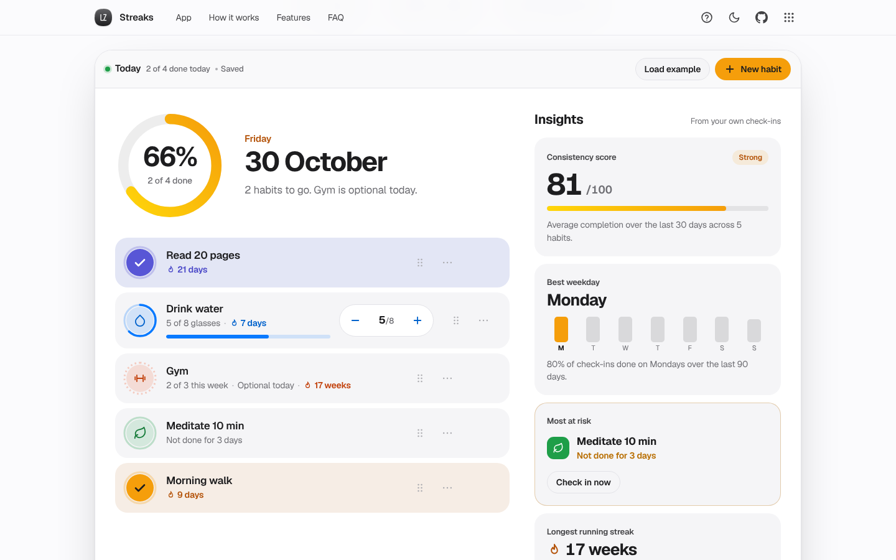

# Streaks

Small habits, kept every day. A habit tracker with one-tap check-ins, daily counts, weekly goals, a year heatmap and insights from your own data.

[](https://lz-streaks.pages.dev/)

Mirror: https://lazarzec18.github.io/streaks/



## Features

**Today**
- A large progress ring with today's date and what is left to do.
- Each habit is a row with a big check button. Checking off plays a pop-and-draw animation; finishing everything fires a short confetti burst (skipped with reduced motion) and a toast.
- Undo on every check-off toast.

**Three kinds of habit**
- Yes or no ("Read 20 pages").
- Count with a daily goal ("Drink water, 8 glasses"), with minus and plus steppers and a progress bar.
- Times per week ("Gym, 3 times a week"). It only joins today's ring when you do it or when every remaining day is needed, so rest days never count against you.

**Habit editor**
- Name, 24 line icons (suggested from the name), 6 colours, type, goal or times per week, and an optional daily reminder time.
- Inline validation for empty, duplicate and out-of-range values.

**Year heatmap**
- 53 x 7 grid of the last year, filterable to all habits or one.
- Tooltips on hover and focus, arrow-key navigation, and a day panel to fix any past day.

**Habit detail**
- Month calendar: select a day, tap again to check it off or fill a count; partial count days show a progress ring.
- A note on any day, listed under Notes and included in backups.
- Current and longest streak, total check-ins, and completion over 30, 90 and 365 days.
- Weekday bar chart and 12-month line chart, both with hover, tap and keyboard tooltips.

**Insights**
- Consistency score (average 30-day completion), best weekday over the last 90 days, the habit most at risk ("Not done for 3 days", or a weekly goal that needs every day left), and the longest running streak.

**Everything else**
- Reminders through the Notification API with a clear permission flow and an in-page fallback. Reminders work while Streaks is open in a browser tab.
- Archive and restore, delete with undo, drag to reorder (or arrow keys on the handle, or Move up and Move down in the menu).
- Export and import a JSON backup with validation and a confirm before replacing data.
- Load example: 5 habits with about 200 days of history and a few notes.
- A 7-step guided tour, light and dark themes, and a layout built for 390px phones.

## How it works

Every check-in is stored against a local calendar key like `2026-10-30`, taken from the device clock rather than UTC, so a 7am tick in Perth never lands on yesterday. All date arithmetic runs on the calendar itself through `Date.UTC`, so daylight saving changes can't add or lose a day. A daily streak counts back from today, or from yesterday if today isn't done yet, so a streak stays alive until the day is actually over. Count habits store the amount for each day and only count the day once it reaches the goal.

Weekly habits count Monday-to-Sunday weeks that hit their target, and the week in progress never breaks a streak. For the today ring, a weekly habit works out how many check-ins it still needs and how many days are left; it is optional until those two meet, then it is due.

All of this lives in `logic.js`, a pure module with no DOM access, which the test suite drives directly with known data: streaks, count completion, weekly states, completion rates, weekday and monthly rates, insights and import validation.

## Tech

- Vanilla HTML, CSS and JavaScript. No frameworks, no build step.
- Hand-drawn SVG charts (monotone curves that never overshoot 0 to 100%), SVG icons and a canvas confetti burst.
- Zec Labs kit (`zl.css`, `zl.js`) for the shared nav, toasts, dialogs, tour and storage.
- Data saved in `localStorage`, versioned, with a one-time migration from Streaks v1.

## Run locally

```sh
python3 -m http.server 8000
```

Then open http://localhost:8000.

## Project structure

| File | What it does |
| --- | --- |
| `index.html` | Page structure: hero, app, how it works, features, FAQ |
| `styles.css` | App styles and habit colour tokens (light and dark) |
| `logic.js` | Pure date, streak, insight, import and example-data logic |
| `charts.js` | SVG bar and line charts with tooltips |
| `icons.js` | The 24 habit icons and UI glyphs |
| `app.js` | UI: today, detail, heatmap, editor, reminders, backup, tour |
| `zl.css`, `zl.js` | Shared Zec Labs kit (unchanged) |
| `_headers` | Cloudflare Pages security and cache headers |

## Testing

A Python Playwright suite (185 checks) covers:

- Streak logic on known data, including local-date handling in Perth and the Sydney daylight saving change.
- Count-habit completion and streaks, weekly target states and today's ring.
- Insight values (consistency, best weekday, most at risk, longest streak), weekday and monthly rates.
- Import validation for broken files, non-backups, v1 backups and bad values.
- Real clicks for adding habits, check-offs, steppers, confetti, calendar toggling, notes, charts, heatmap filtering and day editing, reorder by drag and keyboard, archive, delete with undo, export and import.
- Persistence across reloads, reminders with a mocked Notification API, the full guided tour, no horizontal overflow and 44px targets at 390px, dark mode and reduced motion.
- No console or page errors.

---

Part of Zec Labs, a set of small, polished web apps by [Lazar Zec](https://github.com/LAZARZEC18). See them all at https://lazarzec.pages.dev/
